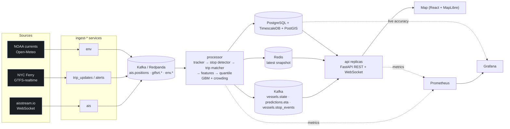

# Architecture

Track My Ferry turns three public feeds into a live map with arrival predictions:

| Feed | What it gives | How often |
|---|---|---|
| **AIS** via aisstream.io (WebSocket) | where every boat in the harbour is: position, speed, heading, name | every 2–10 s per moving boat |
| **NYC Ferry GTFS / GTFS-realtime** | timetable, route shapes, the operator's own predictions, service alerts | static daily; realtime polled every 30 s |
| **NOAA CO-OPS + Open-Meteo** | tidal current at Hell Gate (East River), wind, rain | every 10 min |
| **NYC Open Data ridership** (`t5n6-gx8c`) | hourly boardings by stop, route, direction | published with a lag; downloaded for training |

NYC Ferry's realtime feed has **no vehicle positions**, which is why AIS is the backbone of the map and
why the system has to work out for itself which boat is running which trip.

## Data flow

The same code also runs as **one process** (`trackmyferry run`): sources, pipeline and API share an
in-memory bus. That's the demo mode and is enough for a single small VM.

## Topics and messages

All messages are JSON dataclasses in `trackmyferry/messages.py`. Keys keep each boat's messages in
order on one Kafka partition.

| Topic | Message | Key |
|---|---|---|
| `ais.positions` | `VesselPosition` (mmsi, ts, lat, lon, sog, cog, heading) | MMSI |
| `ais.static` | `VesselStatic` (name, ship type, length) | MMSI |
| `gtfsrt.trip_updates` | `TripUpdate` (official per-stop predictions) | trip id |
| `gtfsrt.alerts` | `ServiceAlert` | — |
| `env.observations` | `EnvObservation` (current, wind, weather) | — |
| `vessels.state` | `VesselState` (what the map draws: position, route, trip, next stop, delay) | MMSI |
| `vessels.stop_events` | `StopEvent` (detected arrival/departure at a landing) | MMSI |
| `predictions.eta` | `Prediction` (p10/p50/p90 ETA, official ETA, chance the boat is full) | trip:stop |

Every message gets `_ingest_ts` when it enters the bus so the processor can report end-to-end
latency (`trackmyferry_end_to_end_seconds`).

## The processing pipeline (`trackmyferry/processing`)

`Pipeline.handle(msg)` is synchronous and deterministic, so it runs identically in the streaming
service, the all-in-one demo and offline replays that build training data.

1. **Tracker** (`tracker.py`) keeps 15 minutes of fixes per boat, drops duplicates and late
   messages, and rejects GPS jumps that would need more than 45 kn.
2. **Stop detector** (`events.py`) emits an arrival when a boat is inside a landing's 150 m
   geofence below 3 kn, and a departure when it leaves or speeds up. Times are corrected for the
   creep-in and acceleration-out between AIS reports. Boats that pass a landing at speed produce
   nothing. These events are the training labels.
3. **Fleet registry** (`fleet.py`) decides which AIS targets are NYC Ferry boats: an allowlist, or
   auto-discovery (docked at two or more NYC Ferry landings within three hours, at least one not
   shared with other operators, passenger ship type).
4. **Trip matcher** (`matcher.py`) scores every (route pattern, scheduled trip) on geometry,
   direction of travel, which landings the boat actually docked at, and how late it would be on
   that trip. It applies hysteresis and makes sure two boats never hold the same trip. If the
   realtime feed names a vessel on a trip, that is used as strong evidence.
5. **Features** (`features.py`) build one row per downstream stop. **Models** (`ml/`) turn rows
   into a p10/p50/p90 arrival time and a chance the boat is full.

## Storage

`trackmyferry/storage/schema.sql` creates plain PostgreSQL tables and upgrades them when extensions
exist: TimescaleDB hypertables plus retention policies, and a PostGIS geography column with a GiST
index. Writes are buffered and flushed every second with `COPY` (stop events use an upsert,
because an arrival and its later departure are the same row). The `prediction_errors` view joins
every prediction to the arrival that actually happened, which powers live accuracy monitoring in
Grafana and `GET /api/accuracy`.

Redis holds the latest vessel snapshot and predictions so a newly started API replica can serve the
map immediately.

## Scaling and failure handling

* **API replicas are stateless.** Each one follows the derived topics with its own consumer group
  and serves WebSocket clients; put any number behind a load balancer.
* **Processor.** One instance handles the whole NYC Ferry fleet with lots of headroom: a replay
  runs at about 2,400 messages/s in one process (1.9 M messages in 13 minutes), while the live
  feed is a few messages per second. To scale out, partition by MMSI. Trip exclusivity is a global
  constraint, so partition by route group or add a small reconciliation step that resolves trips
  claimed by boats on different processors.
* **Back-pressure.** The in-memory bus drops a slow subscriber's oldest messages rather than
  blocking producers. The WebSocket hub batches updates once per second and drops a slow client's
  oldest frame.
* **Source outages.** The AIS client reconnects with exponential backoff, and realtime pollers
  retry on the next tick. A boat with no fix for 15 minutes disappears from the map and releases
  its trip.
* **Clock.** All message timestamps are epoch seconds in UTC. Schedule math follows the GTFS
  "noon minus 12 hours" rule, so daylight-saving days are correct (tested).

## Latency budget (live)

| Stage | Typical |
|---|---|
| Ship transmits → aisstream delivers | 1–5 s (outside our control) |
| Bus + pipeline (track, match, predict) | < 5 ms per message |
| Hub batching to the browser | ≤ 1 s |
| Browser animation | dead reckoning between fixes, so boats keep moving smoothly |

## The map

* **Basemaps.** CARTO's free OpenStreetMap vector tiles. On load, the browser fetches CARTO's hosted
  style and recolors it layer by layer (`web/src/lib/mapStyle.ts`) before MapLibre sees it. The
  **City** theme has light-blue water, green parks, building footprints, white streets and pale cream
  highways, kept pale so the route colors are the only saturated lines on the map. **Night** keeps
  the dark look with navy water. No tile server or API key is needed. `VITE_MAP_STYLE` can point City
  at any other style URL.
* **Demo routes.** The sample network's landings sit on the water's edge, and its route shapes were
  traced through the water on this basemap: shortest paths that keep ~90 m off shore and ~250 m
  clear of landings a route doesn't serve.
* **Boats.** Each boat is a top-down ferry icon in its route's color, rotated to its course, with a
  wake when it is moving (`web/src/lib/shipIcon.ts`). Icons are drawn on a canvas the first time a
  color is needed, through MapLibre's `styleimagemissing` hook, so a live GTFS feed with new route
  colors needs no extra assets. The selected boat gets a pulsing ring.
* **Layer order.** Route lines sit above streets and bridges but under place names; landings and
  boats go on top. A theme switch reloads the basemap and re-adds these layers on `style.load`.
