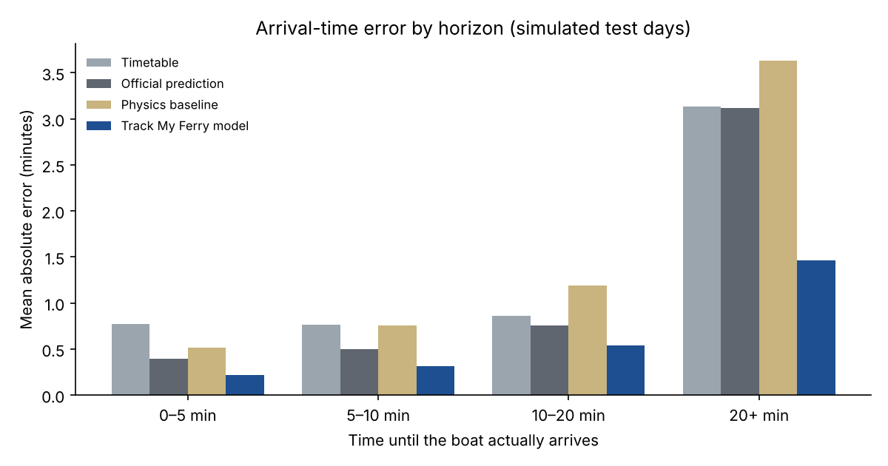
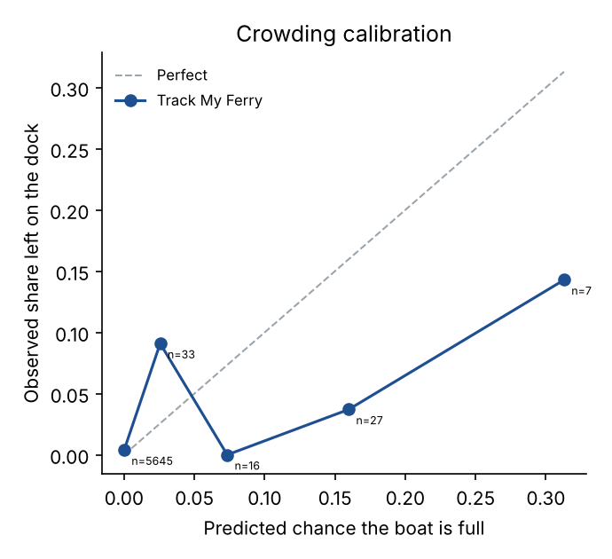

# Track My Ferry evaluation report

Data: simulated · train days: 13 · calibration days: 3 · test days: 5 · test rows: 301,165

> These numbers come from the built-in simulator, not real NYC Ferry operations. They show the pipeline works end to end; rerun `trackmyferry train` on recorded live data for real results.

## Arrival-time accuracy

| Method | MAE | RMSE | 90th pct abs error | Bias | Within 1 min |
|---|---|---|---|---|---|
| Timetable | 1.68 min | 5.19 min | 3.28 min | -76 s | 78% |
| Official prediction (GTFS-RT) | 1.54 min | 5.11 min | 2.45 min | -66 s | 82% |
| Physics baseline | 1.92 min | 5.02 min | 2.52 min | -8 s | 53% |
| **Track My Ferry (p50)** | 0.79 min | 2.99 min | 1.50 min | -27 s | 87% |

Track My Ferry cuts mean absolute error by **48%** vs the official prediction and **53%** vs the timetable.

### By horizon (MAE)

| Horizon | Timetable | Official | Physics | Track My Ferry | n |
|---|---|---|---|---|---|
| 0–5 min | 0.77 min | 0.40 min | 0.51 min | 0.22 min | 48,024 |
| 5–10 min | 0.76 min | 0.50 min | 0.75 min | 0.32 min | 49,534 |
| 10–20 min | 0.86 min | 0.76 min | 1.19 min | 0.54 min | 91,326 |
| 20+ min | 3.13 min | 3.12 min | 3.63 min | 1.46 min | 112,281 |

### By route (MAE)

| Route | Official | Track My Ferry |
|---|---|---|
| AS | 0.80 min | 0.62 min |
| ER | 1.55 min | 0.98 min |
| SB | 2.73 min | 0.79 min |

### Uncertainty band

The p10–p90 band contained the actual arrival **81%** of the time (target 80%); 8% arrived earlier, 11% later. Average band width: 2.37 min. Before conformal calibration it was 76%; margins per stops-ahead bucket (s): 1: +0, 2: +2, 3-4: +2, 5+: +4.

## Arrival / departure detection (labels)

Matched 24,852 of 24,960 true stop visits. Arrival time error: MAE 4.9 s, 90th pct 10.0 s. Departure time error: MAE 2.9 s, 90th pct 5.0 s.

Vessel-to-trip matching was correct for **99.4%** of underway positions.

## Crowding

Ridership data counts people who boarded, not people who wanted to, so demand is censored at capacity on the busiest trips. Expect the model to under-call the most extreme rush-hour crowding; it ranks risky departures well (AUC) and is calibrated in the 1–50% range.

Departures evaluated: 5,728; share with someone left on the dock: 0.47%.
Brier score 0.0048 vs 0.0047 for a constant base rate (skill -0.02); AUC 0.973.

Hourly boardings forecast MAE: 6.32 vs 7.02 for 'same hour last week'.

| Predicted | Observed | n |
|---|---|---|
| 0.000 | 0.004 | 5,645 |
| 0.026 | 0.091 | 33 |
| 0.073 | 0.000 | 16 |
| 0.160 | 0.037 | 27 |
| 0.313 | 0.143 | 7 |

